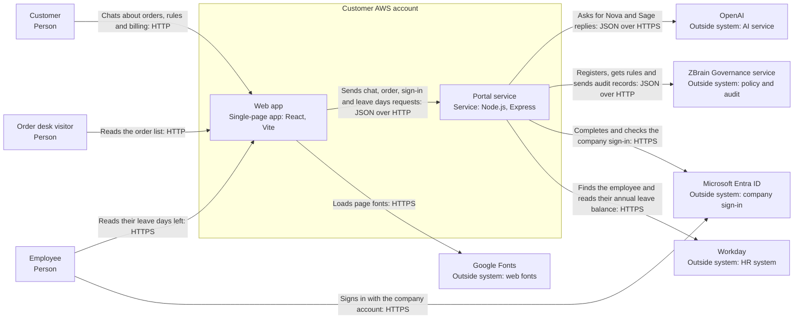

# Architecture diagram: Northstar Support Portal

Container diagram of the whole portal, including the leave days connections. Boxes are people, running parts or outside systems, and arrows show who starts each call. The box "Customer AWS account" holds the Portal service and the Web app files it serves, although the Web app runs in the browser. Browser redirects during sign-in are left out, and nothing is grouped.
