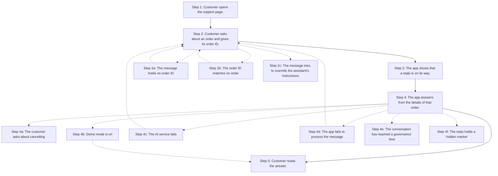
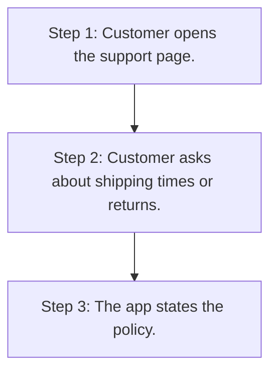
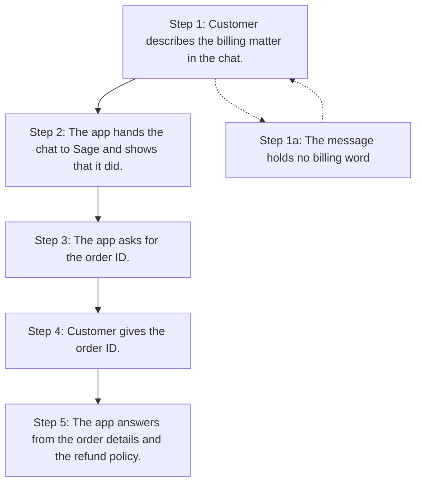
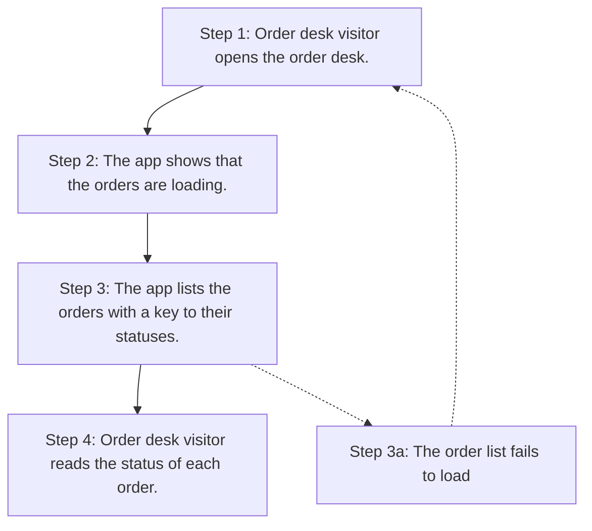
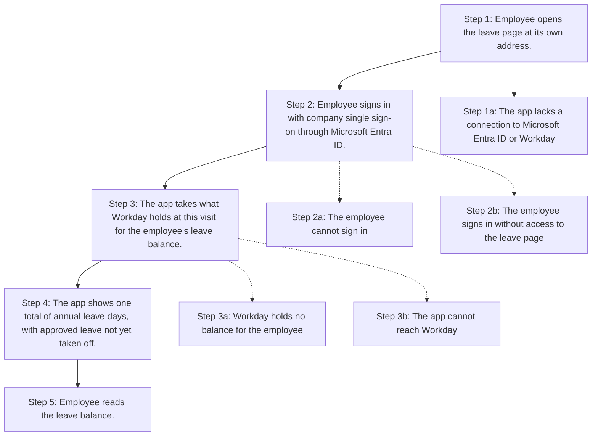

# User journeys: Northstar Support Portal

The journeys cover how customers get support, how order desk visitors read orders and how employees check annual leave days. An order identifier (ID) names one order.

## Journeys
Each row is one goal for one user type.

| User type | Journey | FR ids |
| --- | --- | --- |
| Customer | Get an answer about an order | FR-01 to FR-09, FR-12 to FR-17, FR-28, FR-29, FR-37 to FR-41 |
| Customer | Check a store policy | FR-01 to FR-03, FR-18 to FR-20 |
| Customer | Get billing help | FR-13, FR-21 to FR-27 |
| Order desk visitor | Review the orders | FR-30 to FR-35 |
| Employee | Check annual leave days left | FR-44, FR-46 to FR-52 |

## Customer: get an answer about an order
When: the customer wants to know where an order stands.
Done when: the customer has read an answer about that order.

1. Customer opens the support page. (FR-01, FR-02)
2. Customer asks about an order and gives its order ID. (FR-06, FR-12)
3. The app shows that a reply is on its way. (FR-04, FR-05)
4. The app answers from the details of that order. (FR-03, FR-09, FR-13)
5. Customer reads the answer.

If things go differently:
- 2a. The message holds no order ID: the app asks for it; back to step 2. (FR-14)
- 2b. The order ID matches no order: the app repeats that until the customer starts a new chat; back to step 2. (FR-07, FR-15, FR-16)
- 2c. The message tries to override the assistant's instructions: the app shows the refusal reply; journey ends. (FR-37)
- 4a. The customer asks about cancelling: the app says whether the order status allows it; journey ends. (FR-17)
- 4b. Demo mode is on: the app gives a fixed reply; continues at step 5. (FR-28)
- 4c. The AI service fails: the app asks the customer to try again; back to step 2. (FR-29)
- 4d. The app fails to process the message: the app shows an error message; back to step 2. (FR-08)
- 4e. The conversation has reached a governance limit: the app shows the refusal reply; journey ends. (FR-39, FR-40, FR-41)
- 4f. The reply holds a hidden marker: the app shows the refusal reply; journey ends. (FR-38)

## Customer: check a store policy
When: the customer wants to know a shipping time or the return limit.
Done when: the customer has read the policy.

1. Customer opens the support page. (FR-01, FR-20)
2. Customer asks about shipping times or returns. (FR-02, FR-03)
3. The app states the policy. (FR-18, FR-19)

## Customer: get billing help
When: the customer has a question about a charge, an invoice or a refund.
Done when: Sage has answered the billing question.

1. Customer describes the billing matter in the chat. (FR-21)
2. The app hands the chat to Sage and shows that it did. (FR-22, FR-24)
3. The app asks for the order ID. (FR-26)
4. Customer gives the order ID. (FR-23)
5. The app answers from the order details and the refund policy. (FR-13, FR-25)

If things go differently:
- 1a. The message holds no billing word: Nova says the customer is being transferred; back to step 1. (FR-27)

## Order desk visitor: review the orders
When: the visitor wants to see the orders and their status.
Done when: the visitor has read the order list.

1. Order desk visitor opens the order desk. (FR-30, FR-35)
2. The app shows that the orders are loading. (FR-33)
3. The app lists the orders with a key to their statuses. (FR-31, FR-32)
4. Order desk visitor reads the status of each order.

If things go differently:
- 3a. The order list fails to load: the app asks the visitor to refresh; back to step 1. (FR-34)

## Employee: check annual leave days left
When: the employee wants to know how many annual leave days they have left.
Done when: the employee has seen their leave balance.

1. Employee opens the leave page at its own address. (FR-48)
2. Employee signs in with company single sign-on through Microsoft Entra ID. (FR-46)
3. The app takes what Workday holds at this visit for the employee's leave balance. (FR-47, FR-50)
4. The app shows one total of annual leave days, with approved leave not yet taken off. (FR-44, FR-51)
5. Employee reads the leave balance.

If things go differently:
- 1a. The app lacks a connection to Microsoft Entra ID or Workday: the app says the leave page is not set up yet; journey ends. (FR-52)
- 2a. The employee cannot sign in: the app says the leave page is not available to them; journey ends. (FR-49)
- 2b. The employee signs in without access to the leave page: the app says it is not available to them; journey ends. (FR-49)
- 3a. Workday holds no balance for the employee: see open question Q19 in functional-requirements.md.
- 3b. The app cannot reach Workday: see open question Q20 in functional-requirements.md.

## Requirements not in any journey
These requirements apply in the background or across journeys.

- FR-10: applies to every reply in a long chat.
- FR-11: a note shown with every chat.
- FR-36: applies when the app restarts.
- FR-42: the app records it in the background.
- FR-43: applies when the app starts.
- FR-45: applies to the support page and the order desk as a whole.
