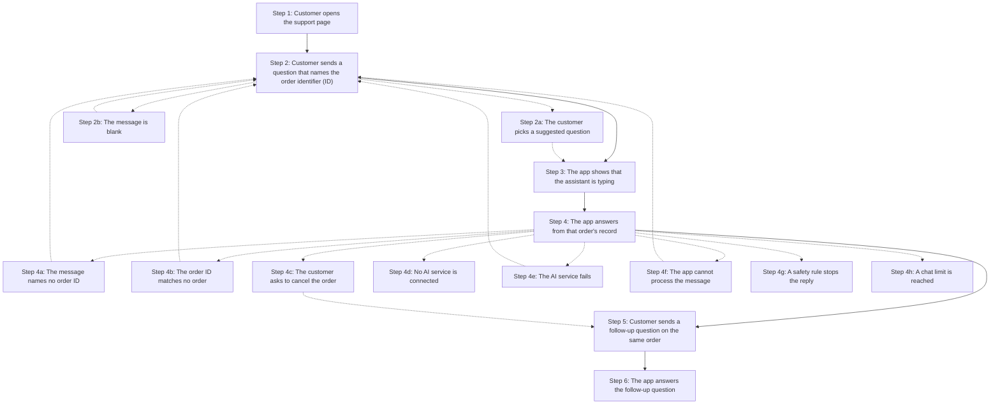
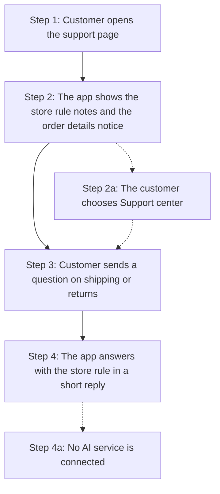
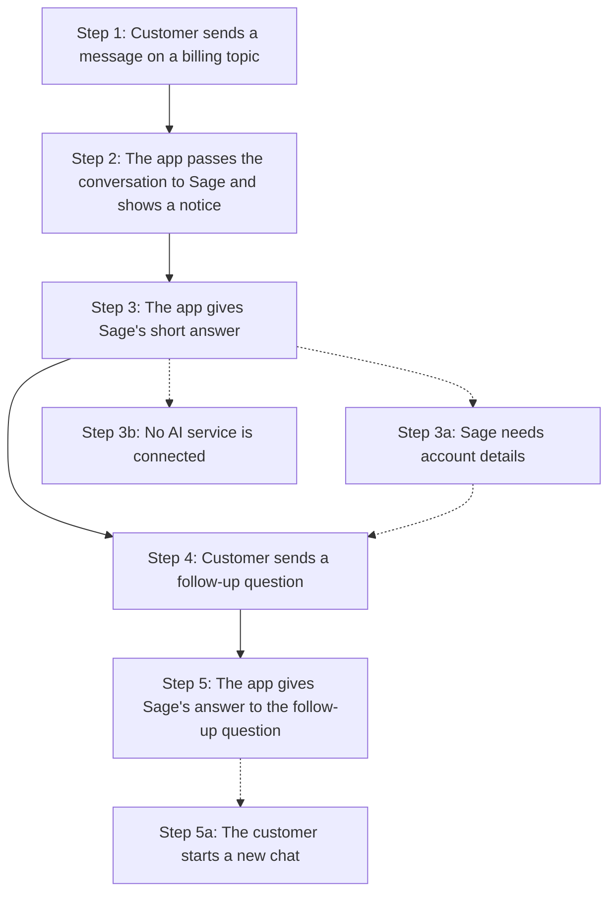
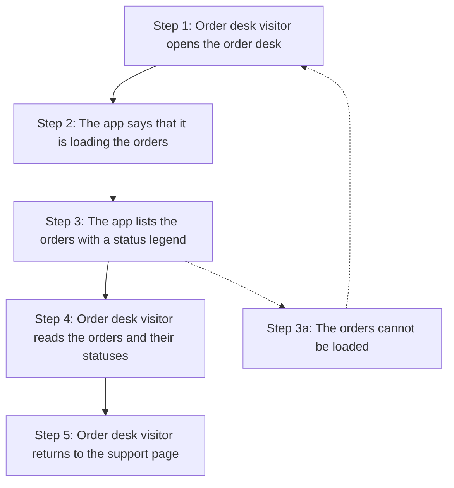
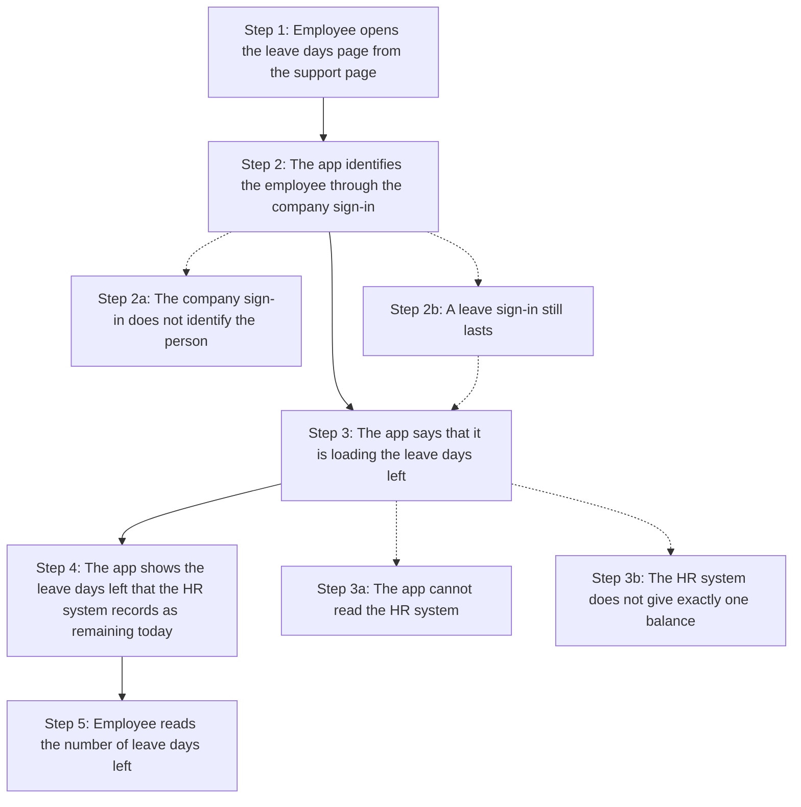

# User journeys: Northstar Support Portal

These journeys cover how customers, order desk visitors and employees reach their goals.

## Journeys
Each user type has at least one journey.

| User type | Journey | FR ids |
| --- | --- | --- |
| Customer | Check on an order | FR-01, FR-02, FR-03, FR-04, FR-05, FR-06, FR-07, FR-09, FR-10, FR-15, FR-16, FR-17, FR-18, FR-19, FR-20, FR-31, FR-33, FR-34, FR-35, FR-36, FR-37, FR-38 |
| Customer | Learn a store rule | FR-01, FR-04, FR-12, FR-14, FR-21, FR-22, FR-24, FR-25, FR-32 |
| Customer | Get billing help | FR-10, FR-13, FR-23, FR-26, FR-27, FR-28, FR-29, FR-30, FR-31, FR-32 |
| Order desk visitor | Review the orders | FR-41, FR-42, FR-43, FR-44, FR-45, FR-46 |
| Employee | See leave days left | FR-47, FR-51, FR-52, FR-53, FR-54, FR-55, FR-56, FR-57, FR-58, FR-59, FR-63 |

## Customer: check on an order
When: a customer wants news of an order.
Done when: the customer has the answer for that order.

1. Customer opens the support page. (FR-01, FR-02)
2. Customer sends a question that names the order identifier (ID). (FR-04, FR-17)
3. The app shows that the assistant is typing. (FR-05, FR-06)
4. The app answers from that order's record. (FR-16)
5. Customer sends a follow-up question on the same order. (FR-09)
6. The app answers the follow-up question. (FR-09, FR-16)

If things go differently:
- 2a. The customer picks a suggested question: the app sends it; back to step 3. (FR-03)
- 2b. The message is blank: the app sends nothing; back to step 2. (FR-07)
- 4a. The message names no order ID: the app asks for it; back to step 2. (FR-18)
- 4b. The order ID matches no order: the app says so; the customer starts a new chat; back to step 2. (FR-19, FR-10)
- 4c. The customer asks to cancel the order: the app states the cancellation rule; back to step 5. (FR-20)
- 4d. No AI service is connected: the app gives the order's status; journey ends. (FR-31)
- 4e. The AI service fails: the app asks the customer to try again; back to step 2. (FR-33)
- 4f. The app cannot process the message: the app shows an error message; back to step 2. (FR-15)
- 4g. A safety rule stops the reply: the app shows the refusal message; journey ends. (FR-34, FR-35)
- 4h. A chat limit is reached: the app shows the refusal message; journey ends. (FR-36, FR-37, FR-38)

## Customer: learn a store rule
When: a customer has a question on shipping or returns.
Done when: the customer knows the store rule.

1. Customer opens the support page. (FR-01)
2. The app shows the store rule notes and the order details notice. (FR-24, FR-14)
3. Customer sends a question on shipping or returns. (FR-04)
4. The app answers with the store rule in a short reply. (FR-12, FR-21, FR-22)

If things go differently:
- 2a. The customer chooses Support center: the app moves to the notes; back to step 3. (FR-25)
- 4a. No AI service is connected: the app gives a prepared reply; journey ends. (FR-32)

## Customer: get billing help
When: a customer has a question on a charge, an invoice or a refund.
Done when: the customer has Sage's answer.

1. Customer sends a message on a billing topic. (FR-26)
2. The app passes the conversation to Sage and shows a notice. (FR-27, FR-29)
3. The app gives Sage's short answer. (FR-13, FR-23)
4. Customer sends a follow-up question. (FR-28)
5. The app gives Sage's answer to the follow-up question. (FR-28)

If things go differently:
- 3a. Sage needs account details: the app asks for the order ID; back to step 4. (FR-30)
- 3b. No AI service is connected: the app gives a prepared reply; journey ends. (FR-31, FR-32)
- 5a. The customer starts a new chat: the app returns to Nova; journey ends. (FR-10)

## Order desk visitor: review the orders
When: a visitor wants to see the orders.
Done when: the visitor has read the orders and their statuses.

1. Order desk visitor opens the order desk. (FR-42, FR-46)
2. The app says that it is loading the orders. (FR-44)
3. The app lists the orders with a status legend. (FR-41, FR-43)
4. Order desk visitor reads the orders and their statuses.
5. Order desk visitor returns to the support page. (FR-46)

If things go differently:
- 3a. The orders cannot be loaded: the app asks for a refresh; back to step 1. (FR-45)

## Employee: see leave days left
When: an employee wants to know their remaining annual leave.
Done when: the employee has read their leave days left.

1. Employee opens the leave days page from the support page. (FR-53)
2. The app identifies the employee through the company sign-in. (FR-51)
3. The app says that it is loading the leave days left. (FR-54)
4. The app shows the leave days left that the HR system records as remaining today. (FR-47, FR-52, FR-56)
5. Employee reads the number of leave days left. (FR-55)

If things go differently:
- 2a. The company sign-in does not identify the person: the app shows the unavailable message; journey ends. (FR-59)
- 2b. A leave sign-in still lasts: the app asks for no new company sign-in; back to step 3. (FR-63)
- 3a. The app cannot read the HR system: the app shows the unavailable message; journey ends. (FR-58)
- 3b. The HR system does not give exactly one balance: the app shows the unavailable message; journey ends. (FR-57)

## Requirements not in any journey
These requirements apply outside a single task.

- FR-08: applies to every customer message.
- FR-11: happens whenever a customer reloads the page.
- FR-39: records every chat for the company, with no user step.
- FR-40: applies when the app starts.
- FR-48: applies when the app restarts.
- FR-49: applies to the whole app.
- FR-50: applies to the whole app.
- FR-60: applies when the app starts.
- FR-61: applies to an employee's later visits.
- FR-62: applies when the app restarts.
